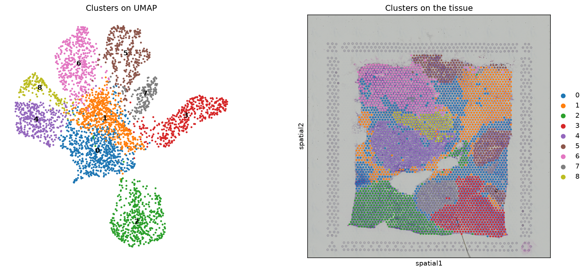
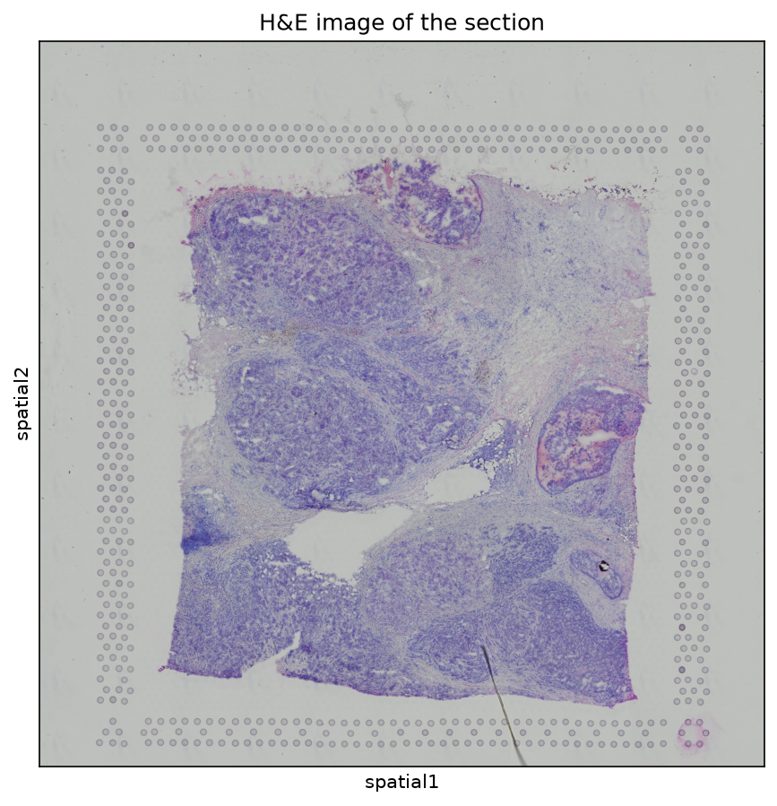
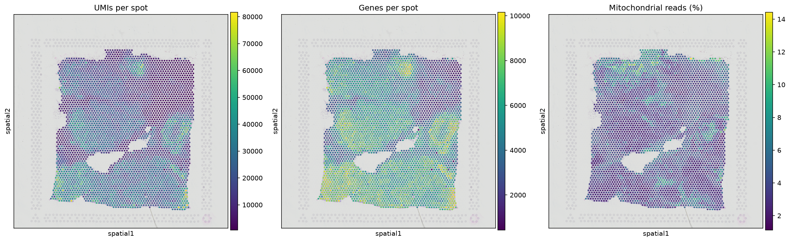
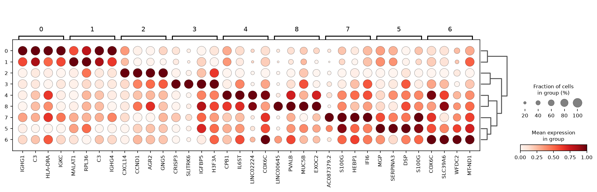
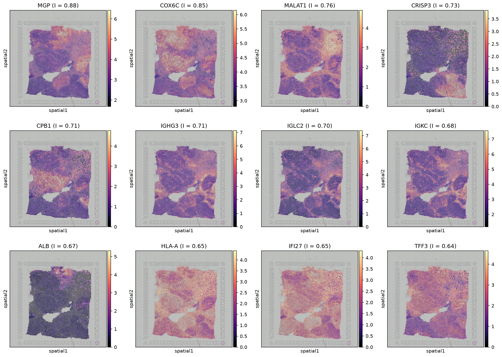
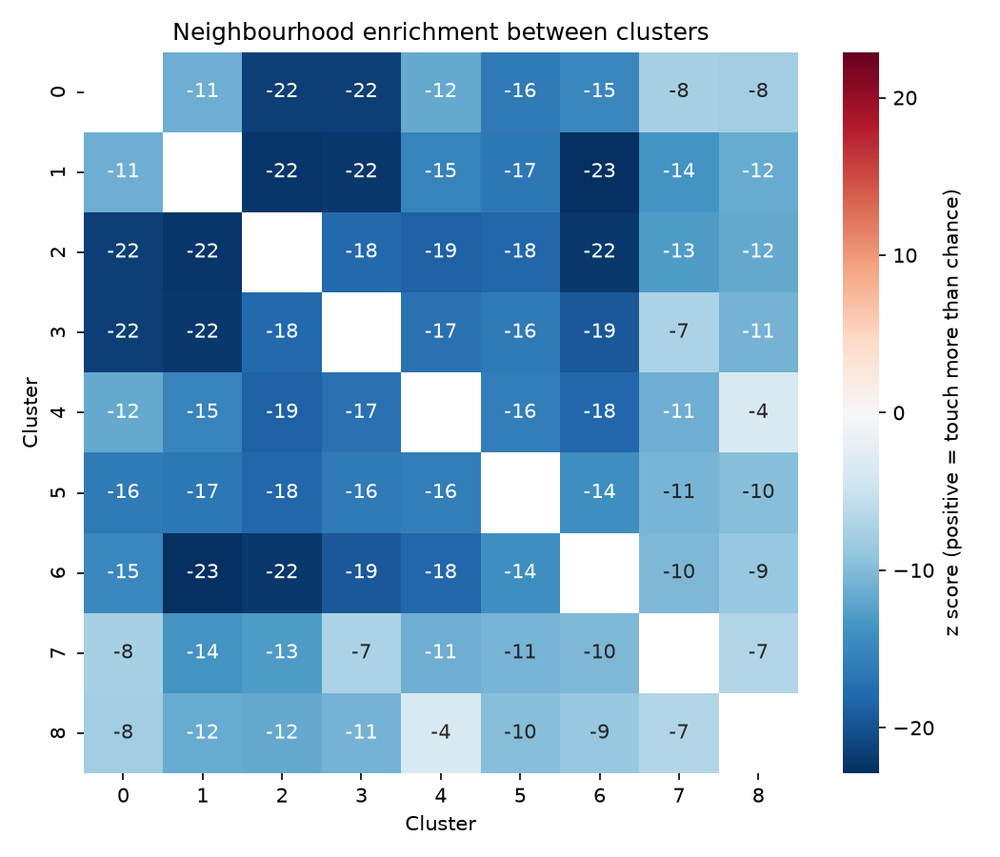
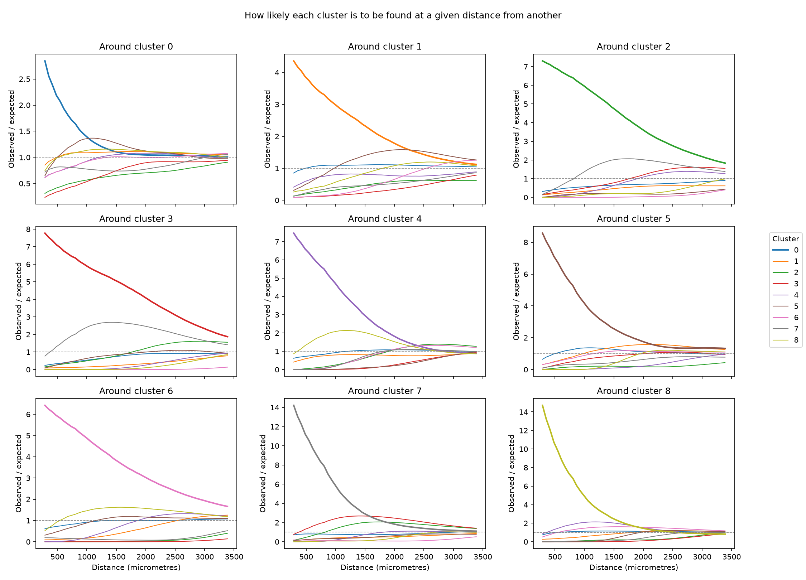
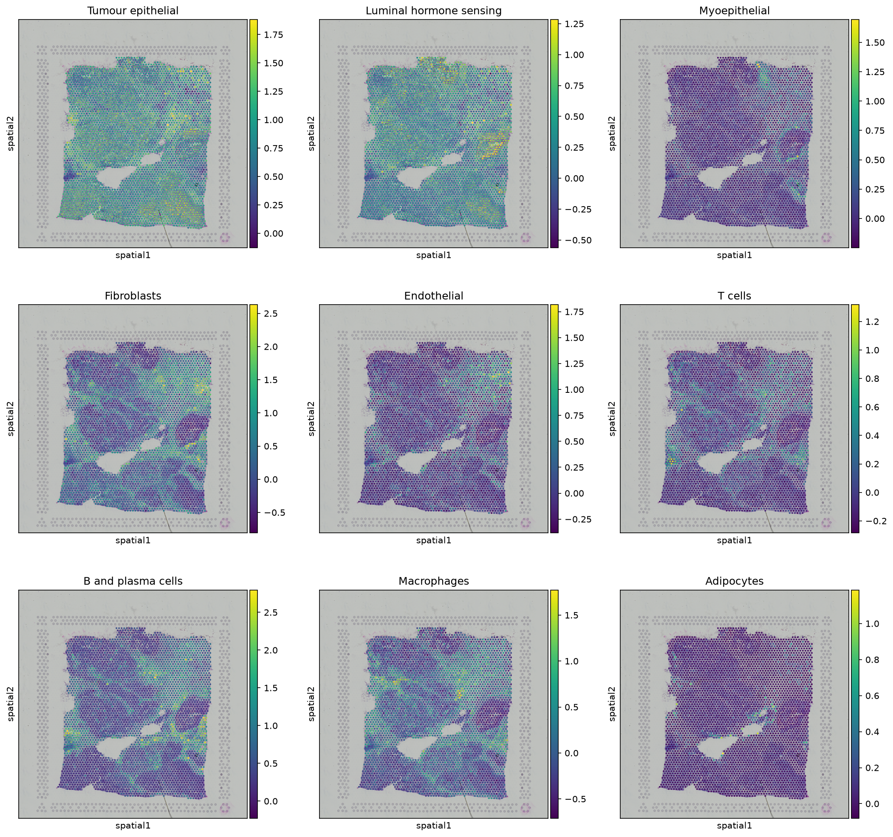
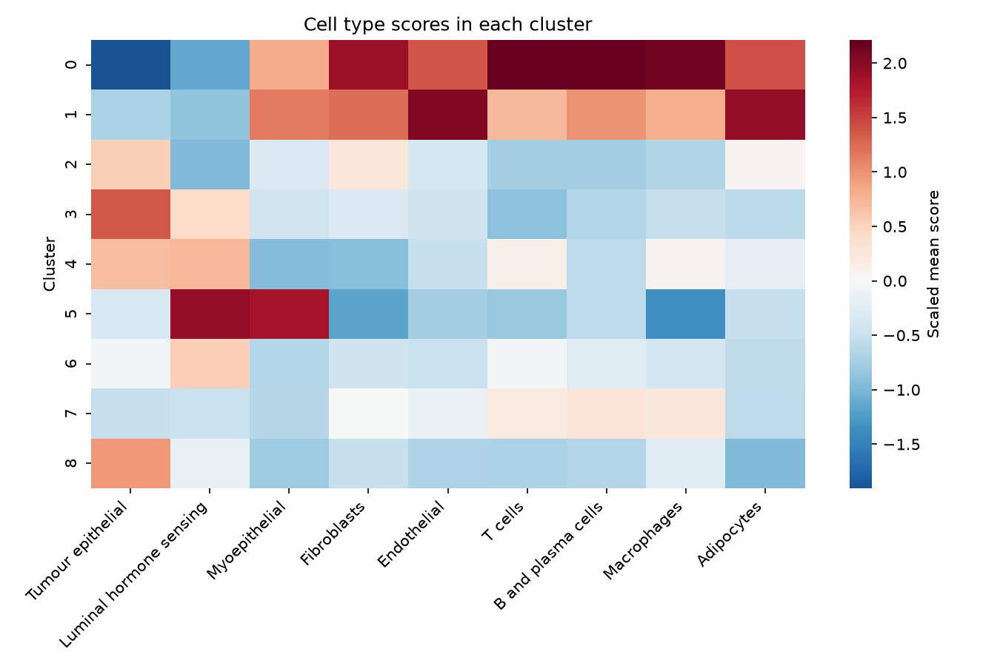
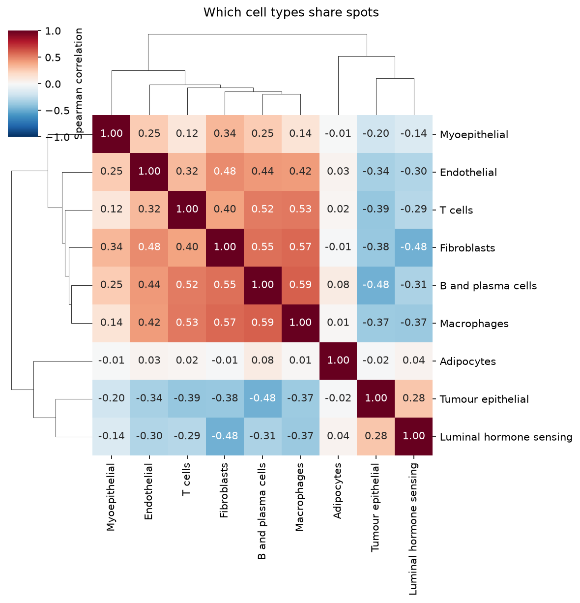

# Spatial transcriptomics: mapping a breast tumour with 10x Visium

This project analyses a public 10x Genomics Visium section of human breast cancer. Visium measures gene expression on a grid of small spots laid over a tissue slice, so we know both **what** genes are on and **where** in the tissue they are on. The pipeline goes from the raw Space Ranger output to tissue regions, spatially patterned genes, neighbourhood statistics and a map of cell types. It uses public data, runs with one command, and every step is explained in plain words.

**Question:** How is this tumour organised in space? Where are the tumour cells, the immune cells and the supporting tissue, and which of them sit next to each other?



## The data

10x Genomics public dataset: [Human Breast Cancer (Block A Section 1)](https://www.10xgenomics.com/datasets/human-breast-cancer-block-a-section-1-1-standard-1-1-0), Space Ranger 1.1.0.

* Fresh frozen invasive ductal carcinoma
* 3,798 spots under the tissue
* About 36,600 genes measured

Each spot is 55 micrometres wide and holds roughly 1 to 10 cells. This matters a lot. A spot is a small mix of cells, not a single cell, and every step below is built with that in mind.

The pipeline downloads the count matrix and the tissue image from 10x. Nothing has to be fetched by hand.



## What the pipeline does

| Step | Script | What happens |
|---|---|---|
| 1 | `01_load_qc.py` | Read the Visium data, check spot quality, and draw quality on the tissue |
| 2 | `02_cluster.py` | Normalize, run PCA, cluster spots with Leiden, and find marker genes |
| 3 | `03_spatial_stats.py` | Spatially variable genes (Moran's I), neighbourhood enrichment and co occurrence |
| 4 | `04_cell_types.py` | Score every spot for nine cell types and see which ones share spots |

All steps are joined together with Snakemake.

## Results

### 1. Quality control

Drawing quality numbers on the tissue is one of the most useful checks in spatial work. Spots with very few reads often sit at torn edges or folds. Here there are no torn or folded patches, but read depth is far from even. The upper right part of the section has many fewer UMIs per spot than the lower part. Loose stroma holds fewer cells than dense tumour, so some of this is real biology. Still, it is worth keeping in mind, because cluster 1 (below) sits right in this low depth area and is partly shaped by it.



Spots were kept if they had at least 1,000 UMIs, at least 500 genes and no more than 20% mitochondrial reads. Only 3 spots failed. 3,795 spots and 19,690 genes went into the analysis.

### 2. Clusters and tissue regions

Clustering the spots on expression alone gives 9 clusters. When we put them back on the tissue, almost every cluster forms one or two solid regions, even though the clustering never saw the spot positions. That is a strong sign the clusters reflect real tissue structure.



Reading the marker genes and the cell type scores (section 4) together, the clusters fall into three groups:

| Clusters | What they look like | Key genes |
|---|---|---|
| 0 | Immune and stromal tissue between tumour areas | IGHG1, IGKC, C3, CD74, C1QA, LUM, DCN |
| 1 | Stroma with blood vessels and fibroblasts, in the low depth area | MALAT1, COL1A2, IGFBP7, BGN, SFRP2 |
| 2, 3, 4, 6, 8 | Different tumour regions, each with its own program | CXCL14, CCND1 (2), CRISP3, SLITRK6 (3), CPB1 (4), COX6C, WFDC2 (6) |
| 5 | Tumour with a strong hormone sensing (luminal) signal | MGP, TFF1, TFF3, S100G, SERPINA3 |
| 7 | Tumour with a strong interferon response | IFI6, IFI27, ISG15, IFIT1, HLA genes |

One take home point is that a single tumour section holds several distinct tumour regions with different gene programs. This is the kind of variation that bulk RNA seq of the same tissue would average away.

### 3. Spatially variable genes

Moran's I measures whether a gene's level in a spot looks like its level in the spots around it. A value near 1 means the gene forms clear patches. A value near 0 means its pattern looks random. The top genes follow the tissue regions closely.



* **MGP, CRISP3, CPB1, COX6C** mark specific tumour regions.
* **IGHG3, IGLC2, IGKC** are antibody genes from plasma cells. They trace the immune rich stroma that runs between the tumour regions.
* **IFI27** shows an interferon response that is strong in some tumour regions and weak in others.

The full ranked list is in `results/tables/spatially_variable_genes.tsv`.

### 4. Neighbourhood enrichment

For each pair of clusters, Squidpy counts how often their spots touch and compares that with 1,000 random shuffles of the labels. All pairs score below zero. This is expected when every cluster forms one compact region, since most of a spot's neighbours belong to its own cluster. The pairs closest to zero are the ones that share borders, for example clusters 4 and 8 (two tumour regions), clusters 3 and 7, and clusters 0 and 7.



The co occurrence plot shows the same idea at growing distances. Each panel shows how likely we are to find each cluster at a given distance from the cluster in the title. A value above 1 means more than chance.



### 5. Cell types in each spot

Since a spot holds several cells, we do not force one label onto it. Instead each spot is scored for nine cell types using well known marker genes. The maps below show where each cell type program is strongest.



* Tumour epithelial and luminal signals cover most of the section.
* Fibroblasts, macrophages, B and plasma cells and T cells follow the same thin bands of stroma between tumour areas.
* Myoepithelial cells show up as thin rims around some tumour regions. This hints that parts of the tumour may still sit inside ducts.



Correlating the scores across all spots shows which cell types tend to share spots. Immune cells, fibroblasts and blood vessels go together. Tumour cells go with none of them. The stroma here forms a shared neighbourhood for most non tumour cells.



## How to run it

You need [conda](https://docs.conda.io) or [mamba](https://mamba.readthedocs.io) and an internet connection. The whole run takes about 5 minutes on a laptop.

```bash
git clone https://github.com/hafizmtalha/spatial-visium-breast-cancer.git
cd spatial-visium-breast-cancer

# Create the software environment (one time only)
mamba env create -f environment.yml
conda activate spatial-visium-breast-cancer

# Run everything
snakemake --cores 4
```

All outputs go into `results/`. Each step writes a log into `logs/`.

## Folder layout

```
spatial-visium-breast-cancer/
├── config/config.yaml        settings: data link, QC cutoffs, clustering options
├── environment.yml           all software with versions
├── workflow/
│   ├── Snakefile             joins the steps together
│   └── scripts/              one Python script per step
├── docs/figures/             figures shown in this README
├── data/visium/              downloaded Space Ranger output (made by the pipeline)
├── results/
│   ├── adata/                AnnData objects after each step
│   ├── figures/
│   └── tables/               QC summary, cluster markers, spatially variable genes, scores
└── logs/
```

## Changing the settings

Everything you might want to change is in `config/config.yaml`.

| Setting | Default | What it does |
|---|---|---|
| `base_url` | 10x breast cancer link | Where to download the data from |
| `min_counts`, `min_genes` | 1000, 500 | Lowest read count and gene count a spot must have |
| `max_pct_mito` | 20 | Highest share of mitochondrial reads allowed |
| `leiden_resolution` | 0.6 | Higher numbers give more, smaller clusters |
| `n_rings` | 1 | How many rings of neighbours count as touching |

## Using it with your own data

1. Point the pipeline at your own Space Ranger `outs` folder. It needs `filtered_feature_bc_matrix.h5` and the `spatial` folder inside `data/visium/`. Then skip the download rule or replace it.
2. Change the marker lists in `04_cell_types.py` to suit your tissue.
3. Any other 10x Visium dataset can be used by changing `base_url` and `sample` in the config.

## A few notes on the choices made

* **Why marker scores and not full deconvolution?** Tools like cell2location or RCTD give cell type proportions per spot, but they need a matching single cell reference and a lot of compute time. Marker scores need neither. They give a clear first picture and are easy to check. A deconvolution step would be a natural next step.
* **Why build the neighbour graph from the grid?** Visium spots sit on a fixed hexagonal grid. Using that grid directly (6 neighbours per spot) is exact and needs no distance cutoff.
* **Why look at QC on the tissue?** A histogram can tell you that some spots are poor, but only the tissue map tells you whether they cluster in a damaged area.

## Software

Scanpy, Squidpy, AnnData, Snakemake. Exact versions are pinned in `environment.yml`.

## References

* Palla G et al. Squidpy: a scalable framework for spatial omics analysis. *Nature Methods* 19, 171 to 178 (2022).
* Wolf FA, Angerer P, Theis FJ. SCANPY: large scale single cell gene expression data analysis. *Genome Biology* 19, 15 (2018).
* Ståhl PL et al. Visualization and analysis of gene expression in tissue sections by spatial transcriptomics. *Science* 353, 78 to 82 (2016).
* 10x Genomics. Human Breast Cancer (Block A Section 1), Spatial Gene Expression Dataset by Space Ranger 1.1.0 (2020).

## License

MIT. See [LICENSE](LICENSE).
